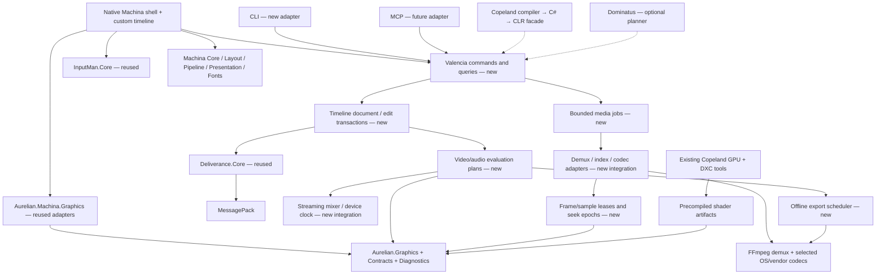

# Valencia infrastructure harvest audit

Audit date: **November 7, 2026, America/Los_Angeles**. Scope: read-only inspection of existing repositories, with C#/.NET prioritized as requested. Output is documentation and audit evidence only. No Valencia application, dependencies, environment changes, new experiments, services, commits, or remote writes were created.

## A. Executive assessment

**We own a credible native graphics/UI/compiler substrate and useful persistence/input libraries. We do not yet own a demonstrated NLE media engine.** Harvest those foundations selectively; build Valencia's timeline, media timing, streaming audio, decode scheduling, export coordination, and editing semantics around explicit contracts.

The highest-value combination is:

1. **Machina.UI shell plus a custom, visibility-culled GPU timeline**, using existing Aurelian native rendering and text adapters. Do not represent every clip or waveform sample as a widget.
2. **Aurelian.Graphics mechanisms**, rather than the game engine/runtime or the entire Stri-V fork. Device creation, textures, barriers, fences, frame targets, and native presentation exist. Video surfaces, YUV conversion, decoder sharing, and a video-frame cache require work.
3. **Deliverance.Core** for versioned, checksummed project snapshots and atomic file replacement; **InputMan.Core** for data-driven keymaps. Both are small independent C# libraries.
4. **Copeland's existing C# backend → Roslyn → managed assembly** for trusted scripts. A small native command facade is the shortest useful route. There is no need to introduce another scripting language or VM.
5. **A new bounded media/editing core**, integrating third-party demux/codec facilities instead of writing codecs. Dominatus can later orchestrate plans through the same command API; it should not schedule audio callbacks or every decoded frame.

**Readiness: ready after specific feasibility experiments, not ready for broad parallel EVT implementation.** The unresolved gates are long-recording seek/timestamps, decoder-to-Vulkan transport, audio device clock/seek behavior, and a dense native timeline. These have concrete experiments and fallbacks in H. The compiler interop and storage routes already have meaningful supporting implementation.

Licensing posture follows the user's clarification: **commercial licensing remains available for user-owned code; GPL/AGPL publication is intentional, not an architectural veto.** Track third-party provenance separately. Aetheris is excluded from the proposed foundation because of poor domain fit, independently of licensing. Nothing here assumes all copyright in inherited or contributed code can be relicensed unilaterally.

### Evidence and estimate conventions

- **Verified**: an existing executable/test was executed during this audit, for the exact binary and behavior identified below.
- **Implemented**: source inspected; behavior not independently demonstrated here.
- **Partial**: implementation exists but has material limits for the claimed capability.
- **Proposed**: a recommendation or documented future capability, not delivered code.
- **Unknown**: missing access, missing evidence, or insufficient coverage.

Existing JSON proof files and README claims are **supporting historical evidence**, not independent verification. Source-derived performance concerns are risks, not measured Valencia regressions.

Reuse grades: **R0** unchanged; **R1** small adapter; **R2** targeted refactor; **R3** substantial extraction/redesign; **R4** reject for this purpose. Grades describe the *named use*, not the entire repository. **New** means no suitable owned implementation found; **Unknown** is not disguised as R4.

Effort ranges are relative planning sizes: **S** roughly days; **M** roughly one to several weeks; **L** several weeks or more. They are not commitments, do not add linearly, and exclude a complete editor's feature development.

## B. Repository inventory and audit coverage

Discovery covered **52 immediate directories** under `C:/Users/yuech/source/repos`, including nested solution/project/package manifests and local Git remotes, plus **67 repositories** returned by the authenticated GitHub connection. The next page at offset 100 was empty. The current `ValenciaNLE` directory began empty, with no Git repository or project files. No repositories were cloned or fetched into local worktrees.

Complete directory/manifests/heads/dirty-state inventory: [local-inventory.json](/C:/Users/yuech/source/repos/ValenciaNLE/docs/audit-evidence/local-inventory.json). Authenticated remote inventory and inspected remote heads: [remote-inventory.json](/C:/Users/yuech/source/repos/ValenciaNLE/docs/audit-evidence/remote-inventory.json). Per-directory and remote-only roles/coverage: [repository-coverage.md](/C:/Users/yuech/source/repos/ValenciaNLE/docs/audit-evidence/repository-coverage.md).

All source paths below are relative to `C:/Users/yuech/source/repos/` unless a remote URL is supplied. Local worktree source, including pre-existing changes, was inspected without alteration. Heads are observation baselines, not claims that dirty files match their commits. A final check observed concurrent work: InputMan advanced to `f9fe1f08a3d87ae5f8287e02992f771c57b9df01` (keyboard keys and action press edges), and Copeland gained uncommitted TinyFarm/Machina cache/state additions while remaining at `114aa374`. These changes were not made by this audit. The relevant additions were read and are distinguished below. [read-only-check.json](/C:/Users/yuech/source/repos/ValenciaNLE/docs/audit-evidence/read-only-check.json) records the observed differences; this is not a claim of byte-identical ignored/generated files.

| Repository / baseline | Actual role and inspected surface | Ownership/license evidence | Coverage |
|---|---|---|---|
| `Copeland` `114aa374` | 256 discovered C# projects; compiler, Machina, Aurelian, integrations, Oblivion, games | Root `LICENSE`: GPLv3; built-in shader package explicitly AGPL-3.0-only; vendored font code has individual permissive notices | Deep selected source/dependency/test audit; bounded existing binaries executed |
| `Deliverance` `97523cc` | 4 C# projects; save containers, migrations, storage | `LICENSE`: MIT, Yuechen Li | Source and selected storage tests |
| `InputMan` `f55011e` → `f9fe1f08` | 14 C# projects; input frames, binding maps, rebinding, adapters | `LICENSE.txt` and Core project: MIT | Source; initially dirty, concurrent commit observed; no fresh qualification |
| `Dominatus` `7b52df3` | 77 C# projects; AI/world actuation, async completion, checkpoint/replay, optional tool adapters | `LICENSE.txt`, Core project: MIT | Core runtime source and bounded tests; optional modules screened |
| `Aetheris` `664ebb6d` | 92 C# projects; CAD/compiler/geometry, document revisioning, bounded materialization cache | `LICENSE`: AGPLv3 | Selected scene/state/cache/shell source; no CAD tests necessary for rejection |
| `HeliosCAD` `14a785c` | Browser/React/Three CAD frontend; 3 C# projects are SolidWorks/tool utilities | `LICENSE`: AGPLv3 | Package/source topology; reject frontend for this task |
| `oct` `fa5b4993`, `Concept` `703d3a8` | Prometheus/SGEMM/FFT/shader infrastructure in Oct; native compiler in Concept | Local licenses; Copeland Prometheus provenance notice | Manifests/provenance and implementation-location screening; no broad non-C# qualification |
| Remote `stri-v` `ca0ff3fd49c653282e4cbd91128168b85743cca0` | Stride hardfork: D3D11/12/Vulkan graphics; FFmpeg and Media Foundation video paths | `LICENSE.md`: MIT; inherited .NET Foundation/Stride/Silicon Studio notices | Selected remote project/source files; no local checkout or build |
| Remote `Aurelian` tree `cef2dd31` | Earlier standalone engine tree and `CodeReferences` copies | Separate repository license must be retained if harvested | Tree/README compared with integrated local topology; not an independent preferred backend |
| `MachinaLayout.JS` `3d92772`, `machina-canvas` `8508247` | JS layout/viewport/canvas packages | Per-repository licenses in inventory | Manifests/tree; design references only, no JS frontend |
| `Ariadne`, `Leviathan` | Dialogue/compiler and conversation/server tooling | Per-repository licenses | C# manifests and selected integration boundaries; not media infrastructure |
| `GumSole`, `IrizaUI`, remote `Gum`, `stride`, `SkiaTest2` | Alternative native/game UI routes | Per-project and inherited terms | Local manifests/source screening; remote-only entries not source-qualified |
| `Riemann`, `Database-Scheduler`/`OctetDB`, nested `NSLab`, nested `Flexture` | Optimization, database scheduling, simulation, alternate layout | Per-project licenses | Discovery/domain screening; not selected as runtime dependencies |
| `WatermarkingExperiment` | Windows C# image watermarking | No root license found | Project/source search; not decode/DSP infrastructure |
| `PCBA`, `CodeNativeDesignDemo`, `roadkill` | DFM web app, CAD demonstration, web/wiki stack | Per-project licenses | Manifest and broad media/state keyword screening; unsuitable full-stack dependencies |
| Remote `visionary` tree `d620ca0c`, `tspack`, `vitest-tspack` | Web editor tooling and build/test infrastructure | Per-repository terms | Remote tree/local manifests; no native NLE subsystem established |

**Named leads resolved:** Aurelian and Machina.UI are active C# subsystems inside Copeland; SDSL-V has an implementation inside `Aurelian.Shaders` and a GPU frontend in `Copeland.TS/Gpu`; Prometheus lives in Oct, with selected algorithms already adapted into Copeland. Helios is not a native C# CAD frontend. No standalone accessible repository or implementation identified as **IntelliDraft** or **ROALoop** was found in the discovered inventory. ROALoop's role in the attached spec is a proposed/human orchestration role, not proof of a reusable runtime. These two remain Unknown, not nonexistent everywhere.

Remote-only repositories are accessible for metadata and selected text reads, but most were not deeply source-audited. Two large recursive-tree requests for Stri-V failed with `Transport closed`; directory and exact-file reads succeeded. A guessed `LICENSE` path returned 404; the actual `LICENSE.md` was read. No capability conclusion depends on those failed requests. Apple documentation's Markdown retrieval also failed; macOS is not qualified here.

### Tests actually executed

Used `dotnet vstest` directly on existing binaries, with TRX output directed into Valencia's audit evidence directory. **335 passed, 0 failed, 0 reported skipped** across nine bounded runs. No builds/restores were run: regenerating other repositories' outputs was unnecessary for this read-only audit. SDKs 8.0.427, 9.0.320, 10.0.114, and 10.0.401 were present.

| Evidence file | Binary / selection | Observed result |
|---|---|---|
| `compiler.trx` | `Copeland.TS.Tests`, `ClrInteropTests`, `InlineCSharpBlockTests`, `ModuleGraphTests` | 26 passed |
| `ui-runtime.trx` | `Machina.Runtime.Tests`, full existing assembly | 60 passed |
| `ui-layout.trx` | `Machina.Layout.Tests`, full existing assembly | 88 passed |
| `ui-presentation.trx` | `Machina.Presentation.Tests`, full existing assembly | 43 passed |
| `ui-widgets.trx` | `Machina.Standard.Tests`: button, form, flat view, text block | 29 passed |
| `audio.trx` | `Aurelian.Audio.Tests`, full existing assembly | 17 passed |
| `graphics.trx` | Native2D submission, texture upload, timeline fence, frame target, sRGB transfer classes | 32 passed |
| `storage.trx` | Deliverance VNext/file store/DTO migration/round-trip selection | 15 passed |
| `automation.trx` | Dominatus async actuation/policy/replay selection | 25 passed |

**Qualification limit:** these are pre-existing build outputs, not fresh builds of the observed worktrees. Machina binaries are dated October 8; compiler/audio/graphics binaries November 4. Current UI source has later edits. Exact commands, binary hashes, timestamps, counts, and names are recorded in [test-executions.json](/C:/Users/yuech/source/repos/ValenciaNLE/docs/audit-evidence/test-executions.json). Verified labels apply to those binaries; current-source findings remain Implemented/Partial unless the exact behavior was exercised.

Several Vulkan tests deliberately **return successfully when device creation or a prerequisite is unavailable**, rather than reporting an xUnit skip. Therefore 32 green graphics tests do **not** prove that all GPU work ran. No decoded-video presentation, sustained audio device playback, window interaction, codec hardware path, or long-recording performance was independently demonstrated. Existing native proof programs write to hard-coded Copeland artifact directories; they were inspected but not rerun to preserve audit locality.

## C. Subsystem findings

### C1. Graphics and compositing

**Recommendation: harvest Aurelian's Vulkan backend, extend its video-facing seams, and keep the engine/game policy outside Valencia. R1 for core mechanisms; R2 for frame transport/lifetime; new NLE composition semantics.**

`Copeland/src/Aurelian/Aurelian.Graphics/Aurelian.Graphics.csproj` references only `Aurelian.Diagnostics` and `Aurelian.Rendering.Contracts`, plus Silk.NET Vulkan/KHR/Windowing. Its transitive project closure is **three projects**, so graphics is already separable from Dominatus, Aetheris, games, and the shader compiler. A compiler is needed to *produce* shaders, not to submit precompiled SPIR-V at runtime.

| Requirement | Implementation and actual limit | Status / disposition |
|---|---|---|
| Device and queues | `Vulkan/Device/VulkanPlantInitializer.cs`, `AurelianVulkanPlant`; explicit plant identity and diagnostics | Implemented, R1; Vulkan-specific, not a multi-API HAL |
| Swapchain and present | `Presentation/VulkanSwapchainFactory.cs`, `AurelianVulkanSwapchain`; `Native2D/VulkanNativeSwapchainPresenter.TryPresent` handles out-of-date by returning false | Implemented, R1; owner rebuilds resources on resize; optional frames-in-flight path exists |
| Commands/synchronization | `Commanding/VulkanCommandBufferPool`, `Commanding/Submit/VulkanCommandSubmitter`, `Sync/VulkanTimelineFence` | Implemented; bounded binary tests passed; R0/R1; respect owner-thread queue access |
| Memory/resource retirement | `Resources/Allocation/IVulkanMemoryAllocator`, `RawVulkanMemoryAllocator`, `GpuResourceState`, `FenceTaggedResourcePool<T>` | Implemented, R1; raw allocation and telemetry, not a proven budgeted video allocator |
| Textures and transfers | `Resources/Textures/VulkanTextureFactory`, `AurelianVulkanTexture`; `Uploads/VulkanTextureUploader.Upload` | Implemented RGBA path, R2 for continuous video; uploader allocates staging and waits for its fence per upload |
| Render targets | `Native2D/VulkanNativeFrameTarget.BeginFrame`, frame sessions, explicit readback | Implemented, R1; use offscreen targets for export, keep readback opt-in |
| Sampling/blending | `Native2D/Native2DContracts.cs`: `NativeQuadSubmission`, `Native2DPipelineOptions.SpriteLinear`, straight-alpha option; `VulkanOrderedQuadRenderer` | Implemented, R1/R2; axis-aligned quad payload is not a general transform/effect/color pipeline |
| Layer composition | `Integrations/Aurelian.NativeComposition/NativeLayerCompositor`, direct same-target ordered passes | Partial for NLE: explicitly rejects offscreen-isolated layers; project also references physics/world/spatial/gamehost |
| Passthrough compositor | `Vulkan/Compositor/VulkanCompositorPassthrough.Dispatch` | One input, matching format/extent copy; **not** the multi-track video compositor |
| Compute | `ComputeMath/VulkanComputeMath`, `ComputeMathBatch`, shader dispatch infrastructure | Implemented; reusable mechanism, but SGEMM/tensor policy is not a video compositor |
| Shader toolchain | `Aurelian.Shaders/Graphics/VdMirGraphicsBackend.Compile`, HLSL → DXC → SPIR-V; SDSL-V lexer/parser/validator/artifact emitters | Implemented, R1; precompile EVT shaders; no shader-language migration needed |
| Color | `NativeSrgbTransfer`, `InputsAreSrgb`, sRGB texture selection; native color correctness proof | Partial: sRGB handling exists; YUV matrix/range/chroma siting/transfer/primaries are new |
| Profiling | allocation/pass metrics, typed diagnostics; compute results include GPU timing | Implemented/Partial; decode/seek/compose/present end-to-end telemetry is new |
| Frame caching | fence-tagged resource reuse and persistent texture bindings | **No NLE cache found**; timestamp/revision keyed CPU/GPU/proxy caches need budgets and eviction |
| Decode interop / YUV | `VulkanTextureFormat` lists RGBA/BGRA/depth/float/integer formats, no NV12/P010; owned texture native handles are internal | Missing video seam. No existing decoder import/release protocol, plane views, external semaphore handoff, or encoder handoff established |

`VulkanOrderedQuadRenderer.UpdateTexture` takes an RGBA byte array and reuses the synchronous uploader. `DisposeTexture` calls `DeviceWaitIdle`. These are reasonable static-asset mechanisms but risks for frame churn. Add a bounded asynchronous upload/reuse seam only after measuring the baseline; do not replace the allocator or renderer wholesale.

The existing layer proof (`tools/Aurelian.NativeLayerCompositorM0/Program.cs`) checks world + analytic UI + MSDF on one target, 100 warm frames, stable image hashes, no repeated atlas uploads, and resizing. Existing `artifacts/aurelian-native-layer-compositor-m0/proof.json` and `aurelian-native-color-correctness-m11a/proof.json` support plausibility; they are historical, not audit-executed demonstrations. The latter records RTX 3070 and validation availability, but that does not qualify today's media path.

**Stri-V alternative:** real D3D11 and Vulkan implementations exist under remote `sources/engine/Stride.Graphics`, plus conditional D3D12 references in its project. `Texture.Direct3D11.cs` includes shared-resource handles and ownership-sensitive COM interfaces. That is useful reference material if a D3D-native media seam becomes necessary. However, its custom SDK, assembly processor, Stride base/shader dependencies, and native deployment make adopting its entire graphics package **R3**, not a small adapter. No reason currently justifies replacing the smaller active Aurelian backend. Remote standalone Aurelian is another historical copy, not a second backend Valencia should combine with local Copeland.

**Decode → compose → preview/export is plausible, not already delivered.** Initially permit a measured CPU RGBA transfer path to establish correctness. The preferred production path retains GPU frames and synchronizes their lease lifetime without CPU readback. Windows Media Foundation's documented D3D11 device-manager path does not automatically share decoder surfaces with Vulkan; external-memory/semaphore compatibility, adapter identity, resource flags, and release timing require a specific proof. [Microsoft D3D11 decoding](https://learn.microsoft.com/en-us/windows/win32/medfound/supporting-direct3d-11-video-decoding-in-media-foundation), [Khronos external-memory extension](https://docs.vulkan.org/refpages/latest/refpages/source/VK_KHR_external_memory_win32.html).

### C2. Native UI and timeline

**Choose option 2: Machina shell + custom GPU timeline.** Machina is a toolkit-independent UI authoring/layout/presentation stack, not a finished docking desktop application.

Evidence:

- `Machina.Pipeline/MachinaPresentationPipeline.Prepare` lowers authoring input, compiles layout rows, resolves the layout, builds a hit-test index, and emits a `MachinaPresentationFrame`. That is a useful reusable boundary. It performs a complete preparation for that call. Concurrent uncommitted `Machina.Pipeline/MachinaPresentationCache.cs` now caches a whole prepared view when a value snapshot of the declaration, viewport and options match. `UiDeclarationSnapshot` still traverses/copies declaration values; any change triggers full preparation. This is useful unchanged-panel reuse, not dirty-subtree diffing, clip virtualization, or an NLE performance proof. `MachinaPresentationCacheTests.EqualReconstructedDeclarationsReusePreparationIncludingParagraphs` and invalidation/error cases exist in new source but were not executed here. The snapshot imports `Machina.Standard.Components`, a dependency absent from the captured Pipeline project-reference closure; reconcile its pending project boundary/build before reuse.
- `Machina.Layout/Resolving/LayoutDocumentResolver` implements stack/grid/frame layout. Existing layout tests ran successfully. `Machina.Standard/Components` and `Authoring` supply buttons, fields, text, badges, switches, scroll regions, and composition. Selected widget tests passed, but the latest StandardUI changes postdate the binaries.
- `Machina.Runtime/Input/UiHitTestIndex.Build` walks nodes; `HitTest` scans candidates in reverse order. It is **not a spatial index despite the name**. Thousands of independent interactive clips should use time/track visibility and a timeline-owned hit test.
- `ScrollbarInteraction` expresses capture/release requests. This establishes interaction state, not a fully general OS pointer-capture implementation for clip dragging. Concurrent new `UiPointerActivation` tracks press/release identity and disabled actions, and `UiStateScope` separates screen-lifetime and activation-lifetime state, with suspension and cancellation. These are useful candidate R1 helpers; they do not themselves call native pointer capture. Their source tests were read but not executed. Native capture loss/focus transitions remain acceptance cases.
- `UiInputContracts.UiKey` is deliberately small: arrows/navigation, F/R/O/E, etc.; it does not contain the complete Premiere shortcut alphabet. `InputMan.Core` already supports arbitrary physical controls, chords, map priority/consumption, focus reset, serialized profiles, and rebinding. Use it for keymaps; expand the desktop input bridge rather than inventing a second keymap engine. The concurrently committed `f9fe1f08` adds F1–F12 and press-edge preservation across map transitions; `FunctionKeyTests` and `MapTransitionTests` were read, not included in this audit's 335 executed tests. Remaining punctuation/navigation/modifier identities and native mappings still need a complete Premiere preset check.
- `Machina.Fonts`, vendored Typography/OpenFont code, presentation glyph runs, MSDF atlas cache, and `Aurelian.Machina.Graphics` adapters exist. They provide a strong text basis. Native IME, arbitrary script shaping/fallback, edit controls, and screen-reader operation were not qualified for an NLE. `UiSemantics` has role/label/disabled/focusable fields but is not a Windows UI Automation bridge.
- `Aurelian.GameHost.Silk/SilkGameWindowAdapter` wraps an initialized native window, pumps events, observes framebuffer resize/focus, and owns disposal. Silk window/bootstrap examples and swapchains exist. Multiple detachable editor windows and docking behavior were not found as complete generic features.
- The existing `Machina.Presenter.Sample/Program.cs` uses **Avalonia** with a raster image presenter. `Integrations/Oblivion.Avalonia/AvaloniaOblivionDiagramCanvas` implements pan/zoom and actual pointer capture. It is native C#, but its bitmap/Oblivion content path is not a zero-copy video monitor.

| UI choice | Assessment | Decision |
|---|---|---|
| Machina widgets throughout | Reuses layout and controls; full layout/hit-test work and lack of clip virtualization create unnecessary timeline risk | Reject for timeline; keep ordinary panels |
| Machina shell + GPU canvas | Reuses GPU/text/layout/input and gives timeline its own visible-range model | **Preferred**, conditional on H1; fixed panel layout first |
| Existing native alternative | Avalonia is already used in Copeland; stronger conventional desktop host route, but existing integrations are domain/bitmap coupled | Keep as fallback; reuse patterns/adapters, do not import Oblivion.App wholesale |
| New native shell toolkit | Would duplicate windowing/layout/text/input infrastructure | Reject; a small Valencia bootstrap is still necessary application code |

For the timeline, store thousands of clips in the engine but emit only visible clip geometry and waveform tiles. Keep frame-accurate time in the model; convert to viewport pixels at the presentation edge using a local origin. Playhead movement should not relayout bins or regenerate waveforms. Dragging/trimming produces transient presentation state and a validated edit on commit; it must not append an undo operation for every mouse-move. Snapping, track targeting, linked selections, time ruler, waveform LOD, and editing gestures are **new** NLE behavior, not Machina features.

High DPI has useful framebuffer/viewport/scale vocabulary, but mixed-DPI monitor transitions remain Unknown. MachinaLayout.JS and Machina Canvas can inform design; porting either runtime would add a second UI architecture. HeliosCAD's React frontend and Cadmata's WebView2 shell violate the fixed frontend decision and are R4.

macOS is a feasibility track: .NET and platform-neutral UI models help, but window input/IME/accessibility, Vulkan presentation/translation support, VideoToolbox surface transport, audio output, and packaging all remain unqualified. No current cross-platform completion claim is justified.

### C3. Copeland TypeScript scripting

**Real route:** `SyntaxTree.Parse` → `Binder.Bind` → `MirLowerer`/`MirValidator` → `CSharpBackend.Emit` → Roslyn assembly compilation → ordinary CLR calls. `CopelandCompiler.CompileToMir` and `CopelandProjectCompiler.CreateSnapshot` are public entry points. The latter resolves host-supplied source modules, validates privacy/cycles, orders modules, and binds explicit metadata contracts; it does not indiscriminately probe the filesystem for source modules.

The language is a defined Copeland dialect, not complete TypeScript/npm compatibility. Source contains records, unions, typed arrays, callable/generic/async constructs, modules, CLR imports, diagnostics, and separate target backends. The audit-executed `ClrInteropTests.Emits_And_Executes_Direct_Framework_Clr_Calls` compiles generated C# through Roslyn and invokes code that reads a file and serializes a record. `Selects_Number_To_Double_Overload_Deterministically`, `Reports_Clr_Specific_Failures_Without_Npm_Fallback`, module graph tests, and inline-C# tests also ran in the bounded selection.

**Concrete ABI limitation:** `Copeland.TS/Semantics/Binder.cs`, `TryProjectClrType` at line 9301 onward, accepts CLR `int`, `double`, string, bool, void and bounded structured cases; it explicitly rejects **long**, float, the other listed integer widths, object, enums, nullable types, pointer/by-ref and open generic types. A raw `long Tick` property is not currently a usable script ABI. CLR argument and member support must be checked against a deliberately small facade rather than exposing the entire editing object model.

Shortest path, **Proposed**:

1. Expose a small prebuilt `Valencia.Scripting` CLR facade with opaque string project/media/job handles, simple supported argument types, and explicit result/query types. Initially carry exact times as canonical strings or opaque time values created by facade methods; do not round long ticks through `number` or put whole-project tick counts in 32-bit `int`.
2. Compile a named exported Copeland function against that facade with `ClrReferences`, emit C#, and compile to a managed DLL. The host supplies the editing service and invokes the entry function off the UI/audio/render threads.
3. Facade calls submit validated versioned commands or queries. Analysis/export calls return job handles; completion is queried/awaited through a supported contract. `detectSilence` first schedules/reads analysis, then a separate transaction applies chosen ranges.
4. Add ergonomic wrappers resembling the user's example only after constructor/member/record/async signatures are proven. That exact JavaScript-looking example is **not an existing API or a compilation claim**.

| Target | Actual evidence | Valencia decision |
|---|---|---|
| C# / RyuJIT | Real backend and executed CLR interop | **Choose** for trusted scripts; .NET runtime + generated helpers/facade; Roslyn required when compiling dynamically |
| NativeAOT | `CopelandBackendTarget` maps it to a native executable and requires a RID | Existing build target, not a hot-loadable native plugin or evidence that an AOT desktop can JIT scripts; defer |
| JavaScript Node/browser | Backend exists; npm sidecar and browser contracts are explicit separate surfaces | Unnecessary for Valencia; no Node/browser requirement for direct CLR calls |
| .NET Wasm / WGSL / VD-MIR | Existing bounded targets or shader lanes | Not an established embedded scripting sandbox or command runtime |
| Bytecode VM | No general-purpose script execution VM established in inspected current C# path | Do not invent one |
| Command-oriented IR | Existing MIR is compiler IR, not a durable editing operation format | Use a domain command plan as facade output where useful; no new compiler target needed |

**Sandbox and determinism:** the CLR metadata resolver seeds from `AppDomain.CurrentDomain.GetAssemblies()` and loads framework metadata; `ClrReferences` is not an allowlist. Inline `csharp { ... }` blocks exist. Typed compilation does not restrict filesystem/network access, loops, time, randomness, or memory. A collectible `AssemblyLoadContext` can support unloading but provides no security boundary. [Microsoft's explicit security limitation](https://learn.microsoft.com/en-us/dotnet/api/system.runtime.loader.assemblyloadcontext?view=net-10.0).

Use trusted local scripts for the first path. Before executing untrusted/agent-authored code, use an explicitly restricted worker process and brokered command access, or accept only declarative command plans. Process separation alone is not a sandbox: OS permissions, filesystem/network restrictions, resource/time limits, and cancellation/termination policy must be defined. Reuse the compiler inside that worker. Replay records accepted command arguments and analysis results, not a claim that rerunning arbitrary scripts is deterministic.

Diagnostics have IDs, messages, UTF-16 position/length and source path; generated C# emits `#line` blocks. Full debugger/PDB/source-map coverage was not tested. The LSP advertises **full document replacement** (`textDocumentSync = 1`) and explicitly does not implement incremental ranges. Project snapshots/asset caches are useful but not evidence of incremental compilation of arbitrary edits. No NLE script latency benchmark exists; compile outside playback and cache by source + toolchain + facade ABI identity.

### C4. Commands, state, serialization, and incremental work

**Deliverance is the clearest persistence harvest: R1.** `Deliverance.Core` targets net8.0 and depends on MessagePack 3.1.9. `DeliveranceService.SaveAsync(SaveRequest)` accepts explicit module payloads, sorts module IDs, validates versions, hashes semantic bytes, writes container metadata, and supports cancellation. `LoadAsync` constructs a candidate with module/schema upgrade checks before application commit. `FileSaveStore.WriteAsync` writes a temporary file, flushes it, and commits using Windows `File.Replace` or the platform-specific move path, with optional backup rotation and per-path locking. Do not use the obsolete mutable module registry for new Valencia code.

Existing tests include `ConcurrentWritesRemainWhole_AndCancelledWritePreservesPrimary`, `MigratableModule_Upgrades_V1_To_V2_OnLoad`, and save/load round trips; the selected existing binary tests passed. These establish a useful storage container and atomic write behavior, **not** complete NLE project migration or power-loss recovery.

Use a versioned declarative Valencia document with stable IDs for assets, sequences, tracks, clips, effects, and links. Store references/fingerprints for large media, not decoded frames or original recordings in the save container. External proxy/index/waveform caches are regenerable. Relative/relocatable asset paths and an explicit relink operation belong to Valencia. Prefer inspectable canonical project DTOs (including a JSON inspection/export path) carried by Deliverance; avoid adding SQLite merely to store a small EVT timeline.

**No complete general editing-command/undo/journal engine was established.** Related code is domain-specific:

- `Oblivion.App/Application/OblivionCommandRegistry` supplies string IDs, descriptors, scopes, resolution and command execution, but commands return an `OblivionWorkspaceSession`; it is not a generic versioned transaction bus.
- `Machina.Runtime/Dispatch/DispatchTable` dispatches UI transitions, not project transactions.
- Dominatus `ActuatorHost` has typed handlers, policies, IDs, completion and owner-tick semantics; its commands concern agent actuation, without Valencia revisions, edit inverses, or a durable edit journal.
- Dominatus `Persistence/ReplayDriver` replays dialogue/external events into agent state. Its `RngSeed` event is explicitly a no-op until RNG is wired. Do not claim it is a deterministic editing replay engine.
- Aetheris `DocumentSession` supplies locked revision checks and geometry definition/occurrence identities; `FirmamentCompilationSession` caches bounded exact part materializations but still parses/solves/validates. These are domain patterns, not an NLE graph or generic incremental engine. Exclude Aetheris as requested.
- `Copeland.Editing/Editing.ts` is draft/parse/accept UI data handling, not video editing or undo history. Its name is not evidence of timeline capability.

Create a small Valencia domain dispatcher rather than generalizing all four existing command systems. This is necessary missing domain infrastructure, not a competing universal framework. Separate:

| Surface | Contract and owner |
|---|---|
| Mutating edit commands | Version, command ID, expected project revision, typed arguments, validation, atomic application, resulting revision, undo information |
| Read-only queries | Immutable document/media/job snapshots; explicit revision/epoch; no undo entry |
| Events | Applied-command/result/job progress observations; not executable commands |
| Transport controls | Play/pause/seek state and seek generation; high-rate seeks coalesce, no project undo history |
| Media delivery | Bounded frame/sample leases, clocks and release fences; never JSON/frame payloads on command bus |
| Analysis/export jobs | Start/cancel/query commands and immutable result artifacts; operations are not undone like trims |

Undo/redo, transaction grouping, canonical command journaling, checkpoint+replay recovery, schema migrations and deterministic revision hashing remain Valencia work. State commits should have one serialized owner; jobs operate on snapshots and submit results with revision checks. Derived invalidation keys should include media identity, requested timestamp/range, relevant edit/effect parameters, output profile, and algorithm version. A generic CAD dependency graph is unnecessary for EVT.

### C5. Media and audio

**Local result:** broad C# source/project searches across the discovered local roots found resident WAV/MP3 playback, game audio actuation and image import facilities, but no general MP4/MKV demuxer, codec pipeline, NVDEC/NVENC/VideoToolbox integration, VFR indexer, encoder/muxer, transcription implementation, loudness meter, or silence detector. Keyword matches such as geometric variables named `p010` are not pixel-format support. Absence means “not found in inspected coverage,” not proof about every remote branch.

**Remote exception: Stri-V has genuine media code.** At the inspected remote head:

- `Stride.Video/FFmpeg/FFmpegMedia.Open` calls `avformat_open_input`/`avformat_find_stream_info`; `SeekToTime` flushes and uses `av_seek_frame(...AVSEEK_FLAG_BACKWARD)`; frame extraction sends packets/receives decoded frames, uses swscale to RGBA, and preserves decoded PTS in `VideoImage.Timestamp`.
- `FFmpegCodec` has D3D11VA code and hardware context setup. Some custom hardware-context setup is commented out; do not infer a qualified zero-copy route from a capability flag.
- `VideoInstance.FFmpeg` advances by nominal `FrameDuration`, reads a bounded number of frames or seeks, and updates/copies a Stride video texture. It selects a video stream for game playback, not an NLE multi-stream/audio delivery API.
- `VideoInstance.Direct3D` uses `IMFMediaEngine`, `SetCurrentTime`, `OnVideoStreamTick`, and `TransferVideoFrame` into a D3D surface. That is an actual OS playback integration, but not independent sample-accurate audio tracks or offline export.
- **Timing defect for our purpose:** `FFmpeg/VideoStream.cs:30-31` computes a double FPS then divides ticks by `Convert.ToInt64(FPS)`. A 30000/1001 rate becomes an integer 30 divisor. `VideoInstance.FFmpeg` then uses that nominal duration for scheduling. Source inspection establishes an unsuitable fractional-rate/VFR model; no live failure was manufactured or claimed.
- `FFmpeg/AudioStream` exposes channel count/sample rate; it does not supply a complete multi-track streaming mixer. No encoding/muxing/export implementation was established by the inspected video module.

Thus **R3 for extracting a media foundation; R4 for adopting the existing playback/timing model unchanged.** Reuse interop knowledge and selected localizable code only when it saves work compared with binding the supported APIs directly. The custom Stride SDK/engine/texture/service dependencies and old FFmpeg structure access make an entire package transplant poor value. [Inspected Stri-V video source](https://github.com/yuechen-li-dev/stri-v/tree/ca0ff3fd49c653282e4cbd91128168b85743cca0/sources/engine/Stride.Video).

**Aurelian audio is useful but is not the NLE audio engine.** `AudioResourceScope` reads complete files, retains `float[]`, accepts mono/stereo resources and explicitly rejects `AudioResourceStrategy.Stream`. `PcmWavDecoder` supports mono/stereo 16-bit PCM WAV. `Mp3Decoder` uses NLayer and materializes the complete decoded clip. The executed `DecodesStereoMp3IntoAResidentClipWithTheSourcePitch` checks a real 440 Hz fixture and resident decoding.

`AurelianAudioRuntime` supports voices, buses, volume/mute/pause, fades and simple sample-rate stepping. `MixVoice` indexes a source frame and advances by a rate ratio; this is not a high-quality resampler. `Update(elapsed)` derives the output block from elapsed wall time and allocates a mix buffer. `NAudioOutputBackend` uses Windows WaveOut, an 80 ms requested latency, a 2-second buffered provider with `DiscardOnBufferOverflow = true`, and counts **submitted** frames; it does not expose an authoritative played-sample clock or seek/flush contract. It also copies float samples to bytes per submission.

A four-hour stereo 48 kHz float recording alone is about **5.53 GB** (decimal), before copies, additional audio tracks or video. Resident-resource architecture is therefore **R4 for long-recording playback**, while decoder fixtures, gain/fade arithmetic and simple bus concepts are R0/R1 references. Streaming buffers, resampling, sample mapping, a device-clock backend, underrun reporting, reverse/J-K-L policy and AV synchronization require new implementation/integration.

ComputeMath already has `ComputeMathBatch.Fft`, bounded to distinct complex32 tensors, power-of-two lengths up to 65,536. This can support a later spectrogram adapter (R1), not a delivered audio analysis pipeline. No windowing/overlap, calibrated spectrogram display, BS.1770 loudness, denoise or auto-duck implementation was established. Waveform min/max pyramids and silence detection should first consume streaming PCM on CPU; do not import a tensor runtime for trivial reductions.

**Recommended media integration decision:** use an explicit demux/index abstraction, an OS/hardware codec backend, and a bounded CPU fallback. FFmpeg `libavformat` is a strong candidate for robust MKV/MP4 packets, streams and timestamps, with the build's actual decoder/encoder inventory controlled separately. `libavcodec` software fallback and swresample/swscale are candidates where necessary, not hidden dependencies already owned. Preserve original rational PTS/DTS/time base, durations, stream starts, edit offsets and discontinuities; derive sequence frames and proxy mapping explicitly. Never require destructive CFR normalization of the original import. FFmpeg's source/build terms depend on configured components. [FFmpeg formats](https://ffmpeg.org/ffmpeg-formats.html), [FFmpeg license/build considerations](https://ffmpeg.org/legal.html).

Media Foundation or NVDEC/NVENC remain **new adapters**, selected after H2/H3. NVDEC documentation distinguishes bitstream decode/postprocessing from application pipeline duties and lists GPU-dependent capabilities; an NVIDIA GPU does not imply every codec/profile is supported. [NVIDIA NVDEC guide](https://docs.nvidia.com/video-technologies/video-codec-sdk/13.0/nvdec-video-decoder-api-prog-guide/index.html). Microsoft's base Media Foundation format table is not a complete guarantee of all installed modern codec/container combinations; probe actual source, transform, stream and encoder capabilities. [Microsoft format documentation](https://learn.microsoft.com/en-us/windows/win32/medfound/supported-media-formats-in-media-foundation).

### C6. Jobs, automation and agents

Dominatus has more real reusable infrastructure than “agent experiment” alone suggests:

- `ActuatorHost.Async.cs` links owner/shutdown cancellation, observes async faults, queues progress and completions, and publishes them on the owning world tick in ID order. Executed tests include `Dispatch_does_not_block_and_completion_publishes_only_on_owner_tick_once`, `Cancellation_and_failure_are_terminal_and_never_publish_late_success`, `Progress_is_queued_until_tick_in_order_and_closed_after_completion`, and policy/replay cases.
- `ActuationPolicies` supplies synchronous predicates and command-type gates. `ActuatorHost` registers typed handlers and IDs and supports owned versus borrowed disposable handlers.
- Optional Standard process adapters and LLM/SemanticKernel integrations exist; server endpoints and checkpoint machinery are agent-world oriented.

This is **R1 for an optional orchestration adapter** and **R3 for turning the whole world runtime into a general media scheduler**. `StartAsync` invokes a handler's initial synchronous portion on the caller; it does not make blocking work asynchronous automatically. Progress queues are not bounded media channels; no unified resource-budget/retry/cache policy for predictable media jobs was established. Exception text is deliberately reduced to generic terminal failures in the async host; diagnostics need correlation to engine errors.

For EVT, use a small application-owned bounded job queue with .NET cancellation/progress and separate limits for decoding, analysis, proxy generation and export. Deterministic edits must not be retried blindly. Cache analysis by source fingerprint, settings and algorithm version; cancellation cannot leave a half-applied edit or final-looking partial export. Retry only classified transient work with idempotent output publication. This domain scheduler is missing infrastructure, not justification for importing an autonomous planner.

Add a CLI and thin MCP transport above command/query/job contracts. No native Valencia MCP implementation exists yet. Existing server/CLI patterns are references; a REST route or agent actuation command is not automatically an MCP protocol implementation. Transcription and highlight selection remain optional analysis providers. No model weights were downloaded, and no existing Gemma/Trellis inference implementation was promoted into speech recognition capability.

## D. Harvest matrix

Evidence entries refer to the exact source paths/symbols in C and the evidence index below. Required work is Valencia-specific unless a source extension is stated.

| Valencia requirement | Existing subsystem | Repository/path | Evidence | Reuse grade | Required work | Risk |
|---|---|---|---|---|---|---|
| Device/queues/swapchain | Aurelian Vulkan | `Copeland/src/Aurelian/Aurelian.Graphics/Vulkan/{Device,Presentation}` | Implemented; G1/G2 | R1 | Bootstrap/resize/failure adapter, S–M | Device/surface lifetime |
| Commands/fences/resource pooling | Vulkan mechanisms | same `/Commanding`, `/Sync`, `/Resources` | Implemented; selected binary tests | R0/R1 | Owner-thread and budget rules, S | Unbounded resource growth if caller misuses pool |
| Video texture upload/cache | RGBA uploader + renderer textures | `/Resources/Uploads`, `/Native2D` | Partial; synchronous wait, byte-array ingress | R2 | Async ring/leases/eviction, M | Per-frame stalls/copies |
| Native GPU preview | Frame target and presenter | `/Native2D/VulkanNativeFrameTarget`, `VulkanNativeSwapchainPresenter` | Implemented; historical proof | R1 | Connect current frame source, M | No decoded-video proof |
| Multi-track video composition | Quad sampling/blending | `/Native2D/VulkanOrderedQuadRenderer` | Partial; not NLE effects/time/color | R1 + New | Video layers, crop/transform/opacity/dissolve, M–L | Color/ownership/transform contracts |
| General layer framework | NativeLayerCompositor | `Copeland/src/Integrations/Aurelian.NativeComposition` | Partial; direct-pass only; physics dependencies | R2 or omit | Prefer direct frame-target adapter; extract only if needed, S–M | Avoid game/physics imports |
| Shaders | Copeland GPU + Aurelian shader tooling | `Copeland.TS/Gpu`, `Aurelian.Shaders/Graphics` | Implemented source | R1 | Compile selected video shaders offline, S–M | DXC/tool deployment; provenance |
| NV12/P010/color conversion | No suitable active Aurelian implementation | `VulkanTextureFormat` absence; Stri-V reference | Missing/Partial | New; Stri-V R3 | Planes/range/matrix/transfer/siting and tests, M | Incorrect blacks/color/chroma |
| Decoder GPU sharing | Stri-V D3D/FFmpeg reference | remote `Stride.Video`, D3D11 textures | Implemented reference; not executed | R3 | New media-surface adapter, M–L | Cross-API handles/fences unsupported |
| Native shell/layout/panels | Machina + Silk | `Machina.UI/*`, `Aurelian.GameHost.Silk` | Implemented; layout/runtime binaries verified | R1/R2 | Desktop panel bootstrap/input bridge, M | Docking/IME/accessibility gaps |
| Dense timeline | No NLE UI; new whole-view cache | Machina presentation/Native2D primitives | Partial shell caching; proposed NLE integration | R1 + New | Visible-range canvas/gestures/clip hit tests, M–L | Scalability not measured |
| Text/waveform display | Machina text/MSDF; no waveform analysis | `Machina.Fonts`, `Aurelian.Machina.Graphics` | Implemented text; missing waveform LOD | R1 + New | Font policy + waveform tiles, M | Atlas lifetime/shaping/precision |
| Keyboard presets | InputMan | `InputMan/src/InputMan.Core` | Implemented; concurrent `f9fe1f08` source read | R1 | Premiere maps and focus rules, S–M | Desktop bridge and text focus conflicts |
| Scroll/capture/DPI | Machina state/capture helpers + existing Avalonia capture example | `ScrollbarInteraction`, `Oblivion.Avalonia` | Partial | R1/R2 | Native capture loss/mixed-DPI proof, M | Drag stuck outside window |
| Accessibility/IME | Semantic labels only | `Machina.Core/Semantics/UiSemantics` | Partial/Unknown | New adapter | Native accessibility/text input integration, M–L | No screen-reader proof |
| Copeland execution | C# backend / CLR binding | `Copeland.TS`, `Copeland.TS.Backend.CSharp` | Verified binary CLR calls; source inspected | R1 | Thin facade/assembly host, S–M | Limited CLR ABI |
| Exact script time | Binder rejects long | `Semantics/Binder.cs:9309` | Partial | R1 facade or R2 compiler | Opaque/canonical time; later Int64 extension, S–M | Overflow or number rounding |
| Script sandbox | No secure embedded sandbox | CLR resolver/inline C# | Missing | New host policy | Trusted EVT; restricted worker later, M | Full process permissions |
| Versioned edit commands | Domain examples only | Oblivion registry, Dominatus handlers | Partial | R4 as turnkey bus; patterns R1 | Small Valencia dispatcher/validation, M | Confusing UI/agent/media operations |
| Timeline/transactions/undo | No NLE implementation | No suitable owner found | Missing | New | Stable IDs, rational time, edit algebra/inverses, L | Semantic correctness |
| Save/reopen/migrations | Deliverance.Core | `DeliveranceService`, `FileSaveStore` | Verified binary round trips/file operations | R1 | Project DTOs/candidate commit/relink, S–M | Container ≠ full recovery |
| Journal/crash replay | Dominatus event replay reference | `Dominatus.Core/Persistence` | Partial, wrong domain | R4 as edit journal | New canonical journal/checkpoints, M | Replay nondeterminism |
| Asset import/stills | Skia/image/GLB asset code | `Aurelian.Assets` project | Implemented; domain-heavy dependencies | R1 leaf adapter / R4 whole manager | Prefer already-used image library behind media import, S | Pulling compiler/model stack for images |
| MP4/MKV demux/index/VFR | Stri-V FFmpeg reference | remote `FFmpegMedia`, `VideoStream` | Partial; nominal-rate timing unsuitable | R3 / New integration | Supported demux/index wrapper, M–L | Long-GOP seek/timebase correctness |
| Video decode/seek | Stri-V MF/FFmpeg | remote `VideoInstance.*` | Implemented playback, unexecuted | R3 | Independent frame source/seek generations, M–L | Game/Stride coupling |
| Long multi-track audio | Aurelian resident mixer | `Aurelian.Audio`, `Aurelian.Audio.NAudio` | Partial; 17 binary tests pass | R4 core playback; leaf math R1 | Streaming mixer/device clock/resampler, L | GB residency; incorrect clock |
| WAV/MP3 fixtures/helpers | PCM/NLayer | `AudioResources.cs`, `Mp3Decoder.cs` | Verified binary fixture tests | R0/R1 | Small-file/reference use, S | Resident only; WAV format subset |
| Loudness/denoise/duck/silence | No full DSP chain | FFT compute primitive only | Missing/Partial | FFT R1; others New | PCM analysis and chosen DSP providers, M–L | Validation/quality, not just GPU speed |
| Export/encoding/mux | No owned NLE export path | OS/vendor APIs; remote playback only | Missing | New integration | Offline frame/sample schedule + encoder/mux, L | Flush/B-frames/timebase/cancellation |
| Proxies | No video proxy service | Generic assets/job patterns only | Missing | New | Async generation + source/proxy mapping, M | Disk budget and lossy mapping |
| Captions/transcription | No STT implementation found | Existing inference is other model domains | Unknown provider / missing integration | New | Word timestamps/provider/results/review, M–L | Model/license/quality unqualified |
| Highlight/multi-aspect | Optional Dominatus planning concepts | Dominatus LLM/context modules | Proposed NLE feature | R1 optional + New | Reviewable edit plan/aspect overrides, L | Content decisions and cost |
| Jobs/cancel/progress | Dominatus async host | `ActuatorHost.Async.cs` | Verified binary bounded behavior | R1 optional | Media-specific bounded scheduler, M | Owner ticks/unbounded progress |
| CLI/MCP/agents | CLI/server/actuation patterns | Copeland/Dominatus/Leviathan | Partial | R1 patterns + New transport | Thin adapters to one engine, S–M | Authority/revision validation |
| CAD scene/incremental graph | Aetheris/Firmament | `DocumentSession`, `FirmamentCompilationSession` | Implemented but CAD-specific | R4 | No dependency; use general principles | Poor domain fit |
| macOS | Platform-neutral contracts, Stri-V conditional platform paths | .NET/Machina/graphics abstractions | Unknown complete path | Unknown/New adapters | Window/render/audio/codec feasibility, L | No Apple hardware validation |

### Approximate foundation breakdown

This is a **work-package breakdown, not a percentage of an editor**. Categories overlap at module boundaries; do not total rows as effort savings.

| Bucket | Concrete contents | Expected effect |
|---|---|---|
| Reusable unchanged | Layout/geometry records, selected typography/input contracts, fence/pool mechanisms, diagnostics, small audio fixtures/helpers | Several leaf packages; substantial implementation already available, little NLE capability by themselves |
| Reusable with adaptation | Native GPU presentation, Machina shell/text, InputMan profiles, Deliverance snapshots, Copeland CLR facade | Approximately five major integration areas; highest expected foundation effort saved |
| Substantial refactoring | Stri-V video extraction and whole graphics adoption; NativeComposition if taken wholesale; resident game audio as streaming engine | Avoid these as primary routes; refactoring would erase much of the reuse advantage |
| Net-new domain implementation/integration | Media index/decode scheduling, streaming audio clock/mixer, timeline edits/undo, video color/composition semantics, cache/proxy policy, export, recovery journal | Dominates NLE correctness and performance effort despite existing low-level code |
| Unknown | Full macOS path, IntelliDraft/ROALoop implementations, remote-only projects not inspected deeply, exact modern codec/GPU combinations | No effort savings credited until tested |

Highest leverage: **Deliverance candidate-save/atomic storage**, **Copeland native CLR calls**, **InputMan maps**, and **Machina text/layout over Aurelian frame targets**. Reuse of graphics avoids recreating native Vulkan mechanics; it does not eliminate video pipeline engineering. Architectural reuse is high at explicit-data/command/presentation boundaries; literal media-code reuse and saved NLE effort are much lower.

## E. Dependency and integration map

The arrows below mean “depends on / calls.” Dashed edges are optional later components. All Valencia-named boxes are proposed boundaries, not created projects.

**Do not add:** Aetheris/CAD kernels, full Stri-V engine, Dominatus AI world on the playback critical path, Helios/React/WebView2, Oct/Concept toolchains at application runtime, Oblivion workspace model, or a second universal graphics/command framework.

The static project-reference graph in [dependencies.json](/C:/Users/yuech/source/repos/ValenciaNLE/docs/audit-evidence/dependencies.json) contains 32 projects reached from selected entry points. It is XML inspection, **not evaluated MSBuild**: imported props/targets, conditional package selection, runtime assets and shader-source provenance require separate packaging validation.

Concrete coupling decisions:

- `Aurelian.Graphics`: three-project closure. Reuse directly through a narrow video adapter, no extraction.
- `Machina.Standard`: three-project closure; `Machina.Pipeline`: ten; `Aurelian.Machina.Graphics`: thirteen (overlapping). These are viable library seams. Avoid `Aurelian.Machina` merely for a translator if it brings `Aurelian.Core` and engine policy that Valencia does not need; inspect the leaf adapter actually used.
- `Copeland.TS.Backend.CSharp`: seven-project closure plus Roslyn. Treat as compiler tooling, not part of frame evaluation. No npm sidecar unless the script explicitly needs that separate facility.
- `Aurelian.NativeComposition`: eleven-project closure including physics/world/spatial. Prefer direct `VulkanNativeFrameTarget`/Machina graphics adapter use. Only move the small layer presenter if an actual shared need appears; do not split the entire engine for Valencia.
- `Deliverance.Core`, `InputMan.Core`, `Dominatus.Core`: each is a single project before packages. Net8 libraries can serve the proposed net10 desktop host; pin/reconcile package versions rather than copying their source by default.
- `Aurelian.Assets` pulls shader/compiler and GLTF/Skia/SVG packages. It is too broad solely for PNG/JPEG import. Use a small image decoder adapter to an already-used dependency; retain asset hashing/manifest validation ideas.
- `Aurelian.Shaders.Builtins` combines source assets under explicit **AGPL-3.0-only**, including an adapted Aetheris temporal policy. Valencia can have **no Aetheris runtime dependency** while still receiving Aetheris-derived shader code through this bundle. If excluding that material, select independent shader artifacts/source and preserve their provenance; this is a content/package boundary, not a ban on commercially licensing your own work.

Duplicates worth consolidating through version selection rather than migrations: standalone Aurelian vs Copeland-integrated Aurelian; Stri-V/Machina `CodeReferences` vs active Machina; vendored Dominatus snapshots vs standalone Dominatus; multiple UI command systems; separate layout engines. Do not combine old and active versions of the same graphics/agent subsystem in one application. `Aurelian.GameSaves` already demonstrates a small Deliverance adapter, but its game DTOs are not Valencia's document model.

### Targeted quality and maintenance risks

| Finding | Exact supporting implementation | Narrow response before affected reuse |
|---|---|---|
| CPU/GPU serialization in upload/disposal | `VulkanTextureUploader.Upload` allocates staging and waits; `VulkanOrderedQuadRenderer.DisposeTexture` calls `DeviceWaitIdle` | Measure, then bounded ring and fence retirement; preserve existing static-asset path |
| Resource wrappers assume correct owner retirement | `AurelianVulkanTexture.Dispose` immediately destroys image/view/allocation | Explicit lease/fence contract; don't dispose while decoder/render/export owns frame |
| Pool has no intrinsic resource cap | `FenceTaggedResourcePool<T>` creates when no retired head is ready; no budget/eviction owner | Add application budgets/backpressure; do not mistake telemetry for enforcement |
| UI preparation and hit testing scale with submitted nodes | `Prepare` rebuilds stages; new whole-view cache snapshots all declaration values; `UiHitTestIndex` walks/scans | Use cache for stable panels, timeline culling and independent hit testing; no unmeasured toolkit rewrite |
| Atlas cache retains identities until disposal | `AurelianMsdfAtlasCache.entries` dictionary, no general LRU shown | Session-scoped atlases and bounded font/size policy; add eviction only if needed |
| Audio can lose samples without an authoritative clock | WaveOut buffer discard and submitted-frame count | New played-sample/underrun/flush interface and pull/callback integration |
| World-owned async runtime | Dominatus dictionaries and owner-tick drains; unbounded progress queue | Keep it above engine jobs; bound/coalesce progress and preserve error correlation |
| Storage global state/collisions | `FileSaveStore.SlotLocks` static dictionary never removes paths; slot sanitizer substitutes invalid characters | Bounded project/session use, stable safe IDs, explicit path API if needed; don't use display names as IDs |
| Version drift | Deliverance pins MessagePack 3.1.9; Copeland centrally pins 3.1.12 | Resolve one deployment graph and run its package checks; no vulnerability verdict inferred solely from version |
| Very large compiler implementation / ambient emission state | `Binder.cs` includes CLR projection near line 9301; `CSharpBackend` uses AsyncLocal emission context | Pin toolchain; bounded facade; targeted ABI diagnostics/tests instead of compiler rewrite |
| Media time assumptions unsuitable | Stri-V integer-rounded FPS scheduling; MF playback abstraction | Do not transplant timing model; retain rational PTS and decode-forward seeking |
| Tests may validate graceful nonexecution | GPU helpers return on unavailable initialization | New feasibility runs must fail/mark unavailable distinctly and record actual GPU operations |

No confirmed leak or unsafe concurrent execution was manufactured from these observations. The risks above identify ownership, bounding or scaling assumptions needing a contract. Existing explicit diagnostics and rejected unsupported modes are strengths worth preserving.

## F. Claude architecture review

The attached `Premiere Lite — PoC Scope Spec.md` is product/architecture input, not implementation authority. Its embedded architecture/gate diagrams were absent from the Markdown text, so this review covers the visible prose/tables only. FilmCraft's source, license assertions, parity claims and reported readiness were not independently audited; do not copy code or inherit factual/legal claims from that document alone.

| Proposal | Existing evidence and decision |
|---|---|
| C# in-process native editor | **Retain** for engine/UI and trusted scripts. Permit bounded worker processes for untrusted scripts or unstable codec/provider isolation; that does not require a browser frontend |
| Machina.UI frontend | **Revise** to shell + GPU timeline. It supplies real layout/text/presentation, not a finished docking NLE toolkit |
| MachinaLayout.JS as an alternative | **Reject** runtime option under fixed frontend constraint; design reference only |
| Aurelian/Stri-V compositor | **Revise** to active Aurelian Vulkan mechanisms with a new video-facing adapter. Passthrough copy is not a compositor; full Stri-V adoption is excessive |
| SDSL-V shader reuse | **Retain selectively**. Existing source/compiler/artifact paths are real. Offline compilation and selected artifacts are sufficient; no mandatory new compiler architecture |
| Copeland TypeScript | **Retain** via C# target and typed CLR facade. Add explicit long-time ABI strategy; do not assume JavaScript-looking code or arbitrary CLR types already work |
| Dominatus as agent runtime | **Optional later**. Async actuation/policy/replay are real; predictable media jobs do not need an AI world or planner |
| Every UI action on one bus | **Revise**: semantic edits/jobs share commands; reads, events, transient interactions and frame/audio delivery have separate contracts. Hover/mouse pixels do not belong in undo history |
| Bus schema is the only UI/engine contract | **Reject as insufficient**. Time, immutable view state, frame leases, audio clocks, seek cancellation epochs, job progress and ownership must also be settled |
| Normalize VFR on import | **Reject as universal/destructive policy**. Preserve source timestamp truth and map sequence/proxy times; generate CFR proxies/output only when appropriate |
| Proxies mandatory on every import | **Revise** to asynchronous policy driven by codec/seek performance and user choice. Opening a four-hour recording must not wait for a whole-file transcode |
| Tick rate 254,016,000,000 | **Retain as an option, not an inherited requirement**. Signed 64-bit storage is feasible for hours; ticks represent several common frame/audio grids exactly but not arbitrary source rationals. Preserve rational source times and checked conversion. Drop-frame is timecode numbering, not a distinct playback cadence. Copeland cannot expose long directly today |
| Sound device master clock | **Retain** during playback, with new played-sample/latency/underrun interface. Existing submitted-frame game audio facts do not satisfy it. Offline export uses its own deterministic schedule |
| OS/vendor codecs solve licensing | **Reject categorical legal conclusion**. APIs are implementation paths, not proof every application/distribution obligation is covered. Keep third-party terms and application distribution review separate |
| Cisco binary fallback | **Retain only under exact binary distribution conditions**, not source-build equivalence. Cisco limits its stated coverage; it is not a guarantee about all patents. [Cisco FAQ](https://www.openh264.org/faq.html) |
| AV1/VP9 + Opus WebM/MP4 built-in | **Revise** to explicit supported container/codec/audio combinations and platform probes. “Royalty-free” is not a pipeline implementation. Start with proven H.264 + AAC MP4 output for the target workflow; WebM profiles later |
| Project storage | **Specify now**: Deliverance-backed versioned document snapshot, external media/caches, relink, candidate load/commit. No database requirement established |
| CPU reference + GPU render | **Retain bounded differential correctness**. Existing CPU raster is UI rectangle/text/shape rendering, not a video/YUV reference compositor. Build a tiny independent media pixel oracle for supported effects, not a second full production NLE renderer |
| Cross-platform native | **Retain as design boundary, defer completion claim**. Windows first; macOS adapter feasibility is unproven |
| FCP7 XML import | **Defer beyond foundation**. No owned implementation established. FilmCraft parser reuse needs a separate source/license/semantics review |
| Captions/highlights/Shorts and full Premiere tutorials in PoC | **Split gates**. Valuable product goals, but they conceal the unproven decode/seek/audio/render foundation. EVT should satisfy G below before expanding to these features |
| Strict ownership split with orchestrator routing every change | **Revise**: shared versioned contracts and fixtures should govern implementation. No ROALoop runtime dependency follows from a human coordination process |

## G. Recommended minimum Valencia architecture

These are **proposed responsibilities**, not project scaffolding or code created by this audit.

| Boundary | Reused or new | EVT behavior |
|---|---|---|
| Desktop host | Machina + existing Silk/native presentation patterns; new application bootstrap | One native window, fixed bins/monitor/timeline panels, keyboard focus; detachable docking deferred |
| Timeline canvas | Aurelian Native2D/text primitives + new visible-range renderer | Multi-track model; visible clip bounds, ruler, playhead, basic waveform tiles, zoom/scroll/select/trim/drag |
| Editing document | New | Stable asset/sequence/track/clip IDs; rational source time, checked 64-bit sequence time; split, trim, move, delete/ripple scope fixed by command semantics |
| Command/query boundary | New small domain dispatcher using established explicit-data patterns | Same validation/transactions for UI/CLI; revision checks; undo/redo for supported edits; query snapshots |
| Project persistence | Deliverance.Core through adapter + new DTOs | Save/reopen timeline and media references, version rejection/upgrade, missing-media relink; autosave checkpoint with explicit recovery policy |
| Media source | New C# adapter to controlled FFmpeg demux and chosen MF/vendor codec path | Probe OBS MKV/MP4, enumerate audio streams, retain rational timestamps, build bounded persistent index, cancellable seek/decode |
| Frame transport | New bounded lease contract + Aurelian resource/fence mechanisms | CPU and GPU frame representations with timestamp/color/epoch; no hot-path JSON or ownership ambiguity |
| Compositor | Aurelian backend + new video shader/plan | SDR video, crop/position/opacity, two overlapping layers, UI overlay; same pixel/color semantics for preview/export |
| Audio transport | New streaming mixer/backend; reuse small math/fixtures selectively | Multiple independent audio streams/tracks, gain, seek/flush, device-master clock, bounded buffers and underrun diagnostics |
| Jobs/cache | New bounded application scheduler; optional Dominatus adapter later | Index/proxy/analysis/export cancellation/progress, budgets, content-keyed intermediates, atomic publication |
| Export | New offline scheduler + selected codec/mux adapter | Supported H.264/AAC MP4 profile, deterministic edit evaluation, encoder drain/mux finalize, cancel leaves no false-success output |
| Scripting/automation | Reuse Copeland compiler; new narrow facade; future CLI/MCP adapters | One script can query and apply native commands after the interop proof. No need for full ergonomic API or autonomous highlight agent in EVT |

**Representative EVT case:** import an actual multi-hour OBS recording with at least two audio streams; probe/index it while usable; perform accurate random seeks; preview with synchronized audio; split/trim/move/delete clips on a basic multi-track sequence; undo/redo; save/reopen; export a short edited section; compare its cuts, sample alignment and frames to the editing document. Codec/profile/recording variation must be stated, not hidden behind a single successful MP4.

Settle these interfaces before parallel implementation:

1. **Time:** source rational timestamps versus sequence time; frame/sample rounding; range end exclusivity; discontinuities; overflow; timecode; proxy mapping; exact scripting representation.
2. **Document and edits:** stable identity, revision increments, edit preconditions, ripple/link/track semantics, transaction grouping, undo results and canonical serialization. The command schema alone does not define these behaviors.
3. **Frame/sample leases:** owner, valid lifetime, CPU plane stride, GPU API/device/format, color metadata, synchronization, release, cancellation/seek generation and stale-result rejection.
4. **Clock/transport:** played-sample clock, device latency, queued versus heard samples, seek flush, underrun/rebuffer and playback-rate policy.
5. **Evaluation/render:** immutable sequence snapshot + requested time/profile → video/audio plan; preview and export share evaluation semantics while differing in scheduling/drop policy.
6. **Jobs/cache:** admission budgets, priorities, cancellation, progress, result identity, atomic publication, disk limits and invalidation.
7. **Script boundary:** supported CLR types, trust level, facade API version, command rights and diagnostics; no implicit Int64 or sandbox support.

This preserves a full-NLE path because media, editing and rendering have stable semantic boundaries. EVT deliberately excludes advanced keyframes, nesting/slip/slide/roll completeness, captions, denoise, highlights, interchangeable render backends, plugin hosts, full docking, and macOS completion. Those can be added without changing the source-time/document/lease architecture if these contracts are correct.

## H. EVT validation plan — proposed, not implemented

Acceptance numbers below are **provisional engineering gates**, not measurements or promised performance. Record GPU/driver/CPU/storage/codec/recording characteristics, cold versus warm state, and unavailable outcomes explicitly. Use one reference machine and a small fixture set before expanding.

### H1. Dense native timeline and monitor shell

- **Purpose / existing code:** establish option 2 using Machina layout/presentation/text/input plus Aurelian Native2D and existing window/present patterns.
- **Fixture:** 10,000 synthetic clips across 32 tracks over four hours, viewport showing at most roughly 500 clips; precomputed waveform tiles and fake preview texture. No codec/model dependency.
- **Procedure:** continuous pan/zoom/playhead drag, trim across viewport edge, keyboard actions with/without field focus, resize and mixed-DPI move; record layout counts, submitted geometry, input-to-paint latency, allocations and GPU timing.
- **Acceptance:** p95 frame time ≤16.7 ms at 1080p on the reference NVIDIA machine; p95 input-to-visible update ≤50 ms; per-frame work proportional to visible items; after warmup no monotonic cache growth over five minutes; capture/focus loss causes no stuck drag. DPI transforms preserve hit targets within one logical pixel.
- **Failure meaning / fallback:** if per-clip widgets dominate, keep custom timeline culling; if desktop input/text/shell gaps dominate, use the existing Avalonia native host route with Machina/render adapters, validating GPU monitor hosting separately. Do not switch frontend languages.

### H2. Decoder frame → existing Vulkan backend

- **Purpose / code:** validate Aurelian frame targets/sampling/presentation and a chosen Windows decoder surface adapter, independently of editing UI.
- **Fixture:** a short 1080p60 clip with frame IDs, color bars, black/white ramps and audio ticks; one NV12 source, one P010 fixture for format negotiation even if EVT export remains SDR.
- **Procedure:** decode and display through the current Aurelian device; compare explicit CPU reference conversion with GPU conversion; record copies, resource ownership, acquire/release fences, validation output and steady-state allocations. Test a bounded RGBA upload baseline and the proposed shared surface path separately.
- **Acceptance:** actual decoder/GPU path recorded, not “unavailable passed”; 1080p60 with p95 decode-ready-to-present ≤33 ms; bounded frame residency; no stale/reused-before-release surface or Vulkan validation errors; RGB error ≤2 code values for agreed 8-bit SDR oracle samples (edges/chroma siting assessed separately). Verify crop/stride/orientation and limited/full range.
- **Failure meaning / fallback:** CPU staging performance adequate means proceed with measured low-copy limitation; shared memory failure means copy on GPU into compatible shareable surfaces, or use a focused D3D presentation/video adapter. Do not port all Stri-V to fix a single handle seam.

### H3. Long OBS index, random seek and proxy policy

- **Purpose / code:** qualify new demux/index/seek adapter, informed by Stri-V's code but without inheriting rounded-FPS scheduling.
- **Fixture:** one real 3–4 hour OBS MKV with multiple audio streams; a short deliberately VFR/B-frame/nonzero-start fixture; H.264 first, HEVC/AV1 capability probes reported separately. Use existing user footage only with read access; no whole-file transcode required to begin.
- **Procedure:** progressive index; 100 seeded seeks including near EOF/keyframe boundaries; decode forward from appropriate keyframe to target; compare source PTS/frame IDs against an independent oracle. Cancel rapid old seeks. Repeat using a proxy and verify source mapping.
- **Acceptance:** every returned frame has the correct presentation interval; p95 warm seek ≤200 ms, cold ≤500 ms on the stated fixture/machine; obsolete seek results never replace the latest generation; index/cache stays within declared budget (initial target ≤512 MB, excluding codec surfaces); a useful first frame does not wait for a completed proxy.
- **Failure meaning / fallback:** separate parser/index cost from GOP decode cost. Use targeted proxies for expensive streams; if timestamp correctness fails, fix index/time contract before GUI work. Do not hide it with unconditional import normalization.

### H4. Streaming multi-track AV clock and export

- **Purpose / code:** determine whether any small Aurelian audio helpers can be retained while validating the new audio/backend clock and offline scheduler.
- **Fixture:** 30-minute generated/short-looped frame-counter and audio impulse source with 44.1/48 kHz tracks, plus a short real OBS edit. No four-hour resident PCM allocation.
- **Procedure:** playback for 30 minutes with seeks/pause/resume, induced UI stalls and device-buffer pressure; measure played-sample/frame alignment. Export a two-minute edited section through the same evaluation plan, then decode the result independently.
- **Acceptance:** AV skew ≤20 ms with no increasing drift; no lost/duplicated audio at edit boundaries beyond specified resampler delay; stale buffered audio gone within 100 ms of seek completion; bounded RAM (initial audio working budget ≤128 MB), underruns counted explicitly; exported duration within one output frame and audio count within the declared rounding/delay policy. Cancelled export leaves a temporary/incomplete file, never a success artifact.
- **Failure meaning / fallback:** replace WaveOut buffering with a clock-capable pull/callback backend, improve resampling/buffering; do not tweak wall-clock mixer updates to conceal drift. Export failure blocks EVT even if preview looks correct.

### H5. Copeland → real C# commands and exact time

- **Purpose / code:** exercise `CopelandCompiler`, project modules, C# backend, Roslyn, and proposed minimal facade with current-source build artifacts when implementation starts.
- **Fixture:** a prebuilt tiny facade exposing query/open/edit/job handles plus a short script; one exact time beyond both 32-bit tick range and binary64's exact-integer range.
- **Procedure:** compile and invoke the script; query a document, apply a trim transaction, query revision, schedule/cancel a dummy job. Verify diagnostic span for an unsupported CLR signature. For the trusted path, deliberately confirm direct framework access is possible so it is never mislabeled sandboxed.
- **Acceptance:** native command executed once with correct revision and exact range; no Node/browser process; repeated accepted-command replay gives the same state hash; unsupported ABI produces a useful diagnostic. Small warm compile+invoke target ≤1 s, reported with cold cost; no UI/render/audio blocking.
- **Failure meaning / fallback:** simplify facade to supported strings/ints/doubles/opaque handles. If exact time must be a numeric script primitive, implement a bounded Copeland Int64 extension through existing compiler stages. Do not add a new language/VM. Untrusted execution remains disabled until restricted-worker criteria are defined.

### H6. Save/reopen, undo and recovery replay

- **Purpose / code:** validate Deliverance candidate/atomic storage plus new Valencia edit algebra, serialization and journal.
- **Fixture:** small declarative project, two external media references, 100 seeded edit transactions, an older schema snapshot, missing media and a deliberately truncated journal tail.
- **Procedure:** replay through the real dispatcher, undo/redo, save/load candidate and commit, relink media, cancel a save, simulate interrupted journal append in a test-owned directory, reject unsupported schemas. Compare canonical semantic state, not raw files containing timestamps/nonces.
- **Acceptance:** identical semantic hashes and object IDs across save/reopen/replay; failed validation leaves prior state/revision untouched; undo/redo returns exact expected states; cancelled save preserves previous primary; recovery accepts only complete validated transactions and reports discarded tail; missing assets remain inspectable/relinkable.
- **Failure meaning / fallback:** narrow edit/journal schema and store full checkpoints more frequently; keep Deliverance atomic writes if sound. Do not introduce a database or event-sourcing framework merely to avoid fixing command semantics.

## I. Risks and unknowns

1. **Media correctness is the main architectural risk.** No multi-hour OBS/VFR/multi-audio/export path has been executed. Stri-V's existing code establishes API experience, not solution completion.
2. **GPU decoder sharing is unresolved.** Existing Aurelian is Vulkan; the easiest Windows hardware decode interfaces commonly produce other API surfaces. Both correctness and total copies must be measured before claiming zero-copy.
3. **Native pro-UI completeness is unresolved.** Timeline performance, docking, complete shortcuts, IME, native accessibility and mixed-DPI capture are not proven by widget snapshots.
4. **Script time and trust boundaries are explicit gaps.** `long` rejection, ambient CLR visibility, inline C# and absent hard execution budgets preclude exposing raw engine types or advertising a sandbox.
5. **Binary freshness limits this audit's verification.** No fresh source builds or GPU proof reruns were performed. Concurrent new cache/state/input changes are source-read only; whole-view reuse must not be confused with proven timeline virtualization. Current-source, deployment and actual-codec qualification belong to the feasibility gate, not to a claimed 335-test source qualification.
6. **Remote-only scope is bounded.** All returned repositories are inventoried; only selected remote candidates were source-read. IntelliDraft/ROALoop are unidentified. No access gap is treated as a negative feature verdict.
7. **Own-code licensing is a product choice with a commercial route available.** Keep attribution/contributor/third-party obligations accurate. In particular, built-in shader source includes an Aetheris-derived policy even when runtime project references do not. No Aetheris dependency is recommended.
8. **Codec distribution remains a concrete build/profile decision.** OS/vendor use, Cisco binaries, FFmpeg configurations and media containers need separate inventories. No categorical patent clearance is asserted.
9. **macOS is unqualified.** Maintain portability in document/command/evaluation contracts; require a separate small Apple hardware proof before scheduling a complete port.
10. **Product scope exceeds foundation scope.** Automated captioned rough cuts and Shorts require STT quality, analysis, UI review and media reliability. Do not use an existing general inference engine as evidence that these product features are already owned.

No human clarification is required to finish this audit. Subsequent human decisions are: initial codec/distribution profile; whether trusted scripts suffice initially; exact EVT editing semantics and performance reference machine; eventual public/commercial licensing terms. The recommended defaults are specified above so these do not become reasons to stall the bounded feasibility work.

## J. Implementation readiness

**Ready after H1–H6's bounded feasibility proofs.** The architecture can converge without importing Aetheris, creating a new scripting language, introducing a JS frontend, or migrating an entire game engine.

Adopt now: **Machina shell + GPU timeline; active Aurelian Vulkan mechanisms; InputMan keymaps; Deliverance snapshots; Copeland C# target and a narrow facade; explicit commands/queries/jobs separate from frame/sample delivery.**

Defer or reject now: **whole Stri-V transplantation, resident game audio as an NLE audio core, mandatory AI framework, destructive VFR import normalization, blanket proxy generation, all-purpose bus-only contracts, and claims of current macOS or zero-copy support.**

The immediate next work, when implementation is authorized, is the feasibility gate—not feature expansion. A successful result needs an actual OBS import/seek/AV playback/edit/save/export route. This audit has completed its requested decision/report deliverable; it has not claimed that Valencia itself or those experiments exist.

### Evidence index

Late source additions: [whole-view cache](/C:/Users/yuech/source/repos/Copeland/src/Machina.UI/Machina.Pipeline/MachinaPresentationCache.cs), [cache source tests](/C:/Users/yuech/source/repos/Copeland/tests/Machina.UI/Machina.Pipeline.Tests/MachinaPresentationCacheTests.cs), [widget state scope](/C:/Users/yuech/source/repos/Copeland/src/Machina.UI/Machina.Runtime/State/UiStateScope.cs), and [pointer activation](/C:/Users/yuech/source/repos/Copeland/src/Machina.UI/Machina.Runtime/Input/UiPointerActivation.cs) were inspected during the final concurrent-change check. Their inclusion does not expand the executed-test claim.

Local paths are anchored to the observed inventory; named symbols and tests are the evidence, not README marketing claims.

- **G1** [Aurelian.Graphics project](/C:/Users/yuech/source/repos/Copeland/src/Aurelian/Aurelian.Graphics/Aurelian.Graphics.csproj), [texture formats](/C:/Users/yuech/source/repos/Copeland/src/Aurelian/Aurelian.Graphics/Vulkan/Resources/Textures/VulkanTextureFormat.cs), [texture uploader](/C:/Users/yuech/source/repos/Copeland/src/Aurelian/Aurelian.Graphics/Vulkan/Resources/Uploads/VulkanTextureUploader.cs), [texture ownership](/C:/Users/yuech/source/repos/Copeland/src/Aurelian/Aurelian.Graphics/Vulkan/Resources/Textures/AurelianVulkanTexture.cs).
- **G2** [Native2D contracts](/C:/Users/yuech/source/repos/Copeland/src/Aurelian/Aurelian.Graphics/Vulkan/Native2D/Native2DContracts.cs), [quad renderer](/C:/Users/yuech/source/repos/Copeland/src/Aurelian/Aurelian.Graphics/Vulkan/Native2D/VulkanOrderedQuadRenderer.cs), [native presenter](/C:/Users/yuech/source/repos/Copeland/src/Aurelian/Aurelian.Graphics/Vulkan/Native2D/VulkanNativeSwapchainPresenter.cs), [layer compositor](/C:/Users/yuech/source/repos/Copeland/src/Integrations/Aurelian.NativeComposition/NativeLayerCompositor.cs), [passthrough mechanism](/C:/Users/yuech/source/repos/Copeland/src/Aurelian/Aurelian.Graphics/Vulkan/Compositor/VulkanCompositorPassthrough.cs).
- **U1** [presentation pipeline](/C:/Users/yuech/source/repos/Copeland/src/Machina.UI/Machina.Pipeline/MachinaPresentationPipeline.cs), [hit-test implementation](/C:/Users/yuech/source/repos/Copeland/src/Machina.UI/Machina.Runtime/Input/UiHitTestIndex.cs), [input contracts](/C:/Users/yuech/source/repos/Copeland/src/Machina.UI/Machina.Runtime/Input/UiInputContracts.cs), [native window adapter](/C:/Users/yuech/source/repos/Copeland/src/Integrations/Aurelian.GameHost.Silk/SilkGameWindowAdapter.cs), [Avalonia capture example](/C:/Users/yuech/source/repos/Copeland/src/Integrations/Oblivion.Avalonia/AvaloniaOblivionDiagramCanvas.cs).
- **S1** [compiler entry](/C:/Users/yuech/source/repos/Copeland/src/Copeland/Copeland.TS/Compiler/CopelandCompiler.cs), [project modules](/C:/Users/yuech/source/repos/Copeland/src/Copeland/Copeland.TS/Compiler/CopelandProjectCompiler.cs), [CLR metadata resolver](/C:/Users/yuech/source/repos/Copeland/src/Copeland/Copeland.TS/Compiler/CopelandClrReferences.cs), [CLR type projection](/C:/Users/yuech/source/repos/Copeland/src/Copeland/Copeland.TS/Semantics/Binder.cs:9301), [C# emitter](/C:/Users/yuech/source/repos/Copeland/src/Copeland/Copeland.TS.Backend.CSharp/CSharp/CSharpBackend.cs), [real CLR interop tests](/C:/Users/yuech/source/repos/Copeland/tests/Copeland/Copeland.TS.Tests/ClrInteropTests.cs).
- **P1** [save service](/C:/Users/yuech/source/repos/Deliverance/src/Deliverance.Core/DeliveranceService.cs), [file store](/C:/Users/yuech/source/repos/Deliverance/src/Deliverance.Core/Storage/FileSaveStore.cs), [atomic/concurrent store tests](/C:/Users/yuech/source/repos/Deliverance/test/Deliverance.Core.Tests/FileSaveStoreVNextTests.cs), [InputMan engine](/C:/Users/yuech/source/repos/InputMan/src/InputMan.Core/InputManEngine.cs).
- **A1** [audio contracts](/C:/Users/yuech/source/repos/Copeland/src/Aurelian/Aurelian.Audio/AudioContracts.cs), [resource limits](/C:/Users/yuech/source/repos/Copeland/src/Aurelian/Aurelian.Audio/AudioResources.cs), [mixer](/C:/Users/yuech/source/repos/Copeland/src/Aurelian/Aurelian.Audio/AudioRuntime.cs), [WaveOut backend](/C:/Users/yuech/source/repos/Copeland/src/Integrations/Aurelian.Audio.NAudio/NAudioOutputBackend.cs), [MP3 fixture test](/C:/Users/yuech/source/repos/Copeland/tests/Aurelian/Aurelian.Audio.Tests/Mp3DecoderTests.cs).
- **J1** [async host](/C:/Users/yuech/source/repos/Dominatus/src/Dominatus.Core/Runtime/ActuatorHost.Async.cs), [async tests](/C:/Users/yuech/source/repos/Dominatus/tests/Dominatus.Core.Tests/AsyncActuationTests.cs), [replay driver](/C:/Users/yuech/source/repos/Dominatus/src/Dominatus.Core/Persistence/ReplayDriver.cs), [Oblivion registry](/C:/Users/yuech/source/repos/Copeland/src/Oblivion/Oblivion.App/Application/OblivionCommandRegistry.cs).
- **L1** [shader bundle license declaration](/C:/Users/yuech/source/repos/Copeland/src/Aurelian/Aurelian.Shaders.Builtins/Aurelian.Shaders.Builtins.csproj), [shader provenance](/C:/Users/yuech/source/repos/Copeland/src/Aurelian/Aurelian.Shaders/Assets/Licenses/Prometheus-NOTICE.txt), [Helios frontend dependencies](/C:/Users/yuech/source/repos/HeliosCAD/package.json), [Cadmata WebView2 project](/C:/Users/yuech/source/repos/Aetheris/Aetheris.Cadmata.Desktop/Aetheris.Cadmata.Desktop.csproj).
- **M1** [Stri-V FFmpeg frame timing](https://github.com/yuechen-li-dev/stri-v/blob/ca0ff3fd49c653282e4cbd91128168b85743cca0/sources/engine/Stride.Video/FFmpeg/VideoStream.cs#L30), [demux/seek/decode implementation](https://github.com/yuechen-li-dev/stri-v/blob/ca0ff3fd49c653282e4cbd91128168b85743cca0/sources/engine/Stride.Video/FFmpeg/FFmpegMedia.cs), [MF playback implementation](https://github.com/yuechen-li-dev/stri-v/blob/ca0ff3fd49c653282e4cbd91128168b85743cca0/sources/engine/Stride.Video/VideoInstance.Direct3D.cs), [video dependencies](https://github.com/yuechen-li-dev/stri-v/blob/ca0ff3fd49c653282e4cbd91128168b85743cca0/sources/engine/Stride.Video/Stride.Video.csproj).
